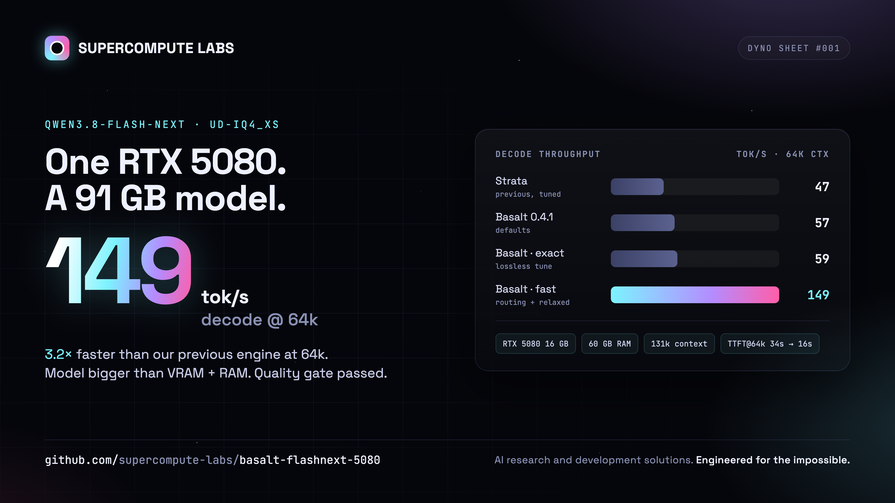

# Flagship

**The Supercompute Labs inference stack.**
*AI research and development solutions. Engineered for the impossible.*

Flagship gets large models running fast on hardware that shouldn't be able to run them. It has three parts:

1. **Tools.** Cold-prompt benchmarking, A/B tuning with interleaved controls, and quality gates. Any OpenAI-compatible engine works.
2. **Method.** A documented process for turning a stock server into a tuned one without fooling yourself. See [docs/METHODOLOGY.md](docs/METHODOLOGY.md).
3. **Recipes.** Tuned, reproducible configs per model × hardware × engine. Each recipe ships with its raw data, its failures, and a quality verdict.



## Recipes

| # | Model | Hardware | Engine | Decode @ 64k | Quality gate |
|---|---|---|---|---|---|
| [001](recipes/qwen38-flashnext-rtx5080-basalt) | Qwen3.8-Flash-Next UD-IQ4_XS (91 GB) | RTX 5080 16 GB + 60 GB RAM | Basalt 0.4.1 | **47 → 149 tok/s** | ✅ passed (small gate) |
| 002 | DeepSeek-V4.1-Flash | RTX 5080 16 GB + 60 GB RAM | Basalt 0.4.1 | *in progress* | — |

## Layout

```
flagship/
├── tools/
│   ├── bench.py     cold-prompt prefill/decode sweep (0k → 120k), engine-agnostic
│   ├── tune.py      restart-per-config A/B runner, parses engine-side rates, ledger output
│   └── gate.py      quality gate: exact-answer Q&A, long-context needles, prose sample
├── docs/
│   └── METHODOLOGY.md   how we find the fast settings and prove they are real
├── recipes/
│   └── qwen38-flashnext-rtx5080-basalt/
│       ├── README.md    results, flags, what didn't work, caveats
│       ├── launch.sh    fast | exact
│       ├── plans/       the exact config sets that were tested
│       └── results/     raw ledgers, every run, failures included
└── assets/
```

## Quick start (recipe 001)

```bash
export BASALT_API_KEY=...          # your server key
export BASALT_DIR=~/basalt-0.4.1   # Basalt release + .venv + .basalt pack
./recipes/qwen38-flashnext-rtx5080-basalt/launch.sh fast    # ~137–149 tok/s, lossy routing
./recipes/qwen38-flashnext-rtx5080-basalt/launch.sh exact   # output-preserving, ~63 tok/s

python3 tools/bench.py my-run results.json http://127.0.0.1:8080/v1 <model> $BASALT_API_KEY
```

## Roadmap

- [x] Recipe 001: Qwen3.8-Flash-Next on RTX 5080
- [ ] Recipe 002: DeepSeek-V4.1-Flash on RTX 5080
- [ ] `flagship` CLI: `bench · tune · gate · report`, with plans in YAML
- [ ] Larger gate: GSM8K subset, tool-call/JSON exactness, 6+ samples per config with medians
- [ ] Engine adapters: llama.cpp, vLLM, SGLang
- [ ] Auto-generated recipe cards and social graphics
- [ ] Fit calculator: will model X run on my hardware, and how fast?

## Principles

- **Cold or it didn't happen.** Prompt-cache hits are not prefill speed.
- **One change at a time, with controls.** Run-to-run noise here is ±5–10%, so a "win" smaller than that is not a win.
- **Lossy is labeled lossy.** Output-changing speedups ship as a separate mode, and only after they pass the quality gate.
- **Publish the failures.** Configs that didn't help are data too.

MIT licensed. Models and engines are under their own licenses.
